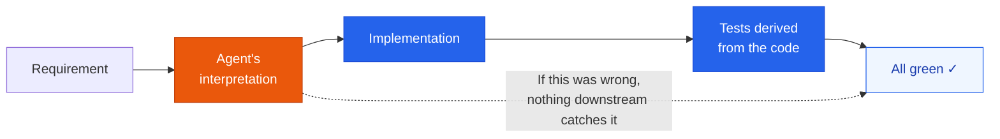
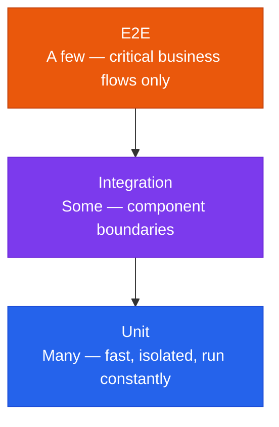

How to keep tests meaningful when the same agent writes both the code and the tests.

## The circular validation problem

When an agent implements a feature and then writes the tests for it, the tests are derived from the implementation rather than from the requirement. A misread requirement produces wrong code, and then tests that assert the wrong code behaves exactly as written. Everything passes. The suite is green and proves nothing, because both sides came from the same misunderstanding.

This is not a failure of the model's reasoning. It is a structural problem: a test only has authority when its expected value comes from somewhere the implementation did not.

## Breaking the loop

### 1. Define expected behavior before the implementation exists

The expected values in a test must trace to a source outside the agent's interpretation:

| Source of truth | What it pins down |
|---|---|
| **Specification** | The behavior the feature is supposed to have, written before code |
| **API contract** | Request and response shapes, status codes, error cases |
| **Acceptance criteria** | The conditions under which a human agrees the work is done |
| **Existing production behavior** | For a refactor, the current output is the specification |

A practical form: write the acceptance criteria as concrete input/output examples, hand those to the agent as the test fixtures, and let it write the implementation to satisfy them. The agent still writes most of the code — it just does not get to decide what correct means.

### 2. Separate the writer from the checker

Never let the agent that wrote the code grade its own work in the same pass. Separation can be procedural or structural:

| Separation | How it works |
|---|---|
| **Different step** | Tests are written against the spec in a step that cannot see the implementation |
| **Different agent** | A reviewing agent receives the requirement and the diff, and is not the one that produced the diff |
| **Different direction** | Tests first, implementation second — the test cannot be shaped to fit code that does not exist yet |

The [evaluator–optimizer pattern](/docs/orchestration/agent-interface/#harness-patterns) is this idea as a harness: one agent drafts, a separate one judges against stated criteria. Its value here comes entirely from the judge's criteria being independent — an evaluator handed the implementation as its standard reproduces the same loop one layer up.

> **Tell:** if a test's expected value was copied from a failing run's actual output, the loop has closed. That edit changes what the test asserts, not what the code does.

## Keeping the feedback loop fast

Lowering the cost of writing tests makes it tempting to write expensive ones. Keep the usual distribution:

| Layer | Volume | What it buys | What it costs |
|---|---|---|---|
| **Unit** | Many | A loop fast enough for an agent to self-correct within a single task | Little — they stay cheap if they stay isolated |
| **Integration** | Some | Confidence at the boundaries unit tests mock away | Slower, and more setup to maintain |
| **E2E** | Few | Proof the critical business flows actually work end to end | Slow and brittle; a large E2E suite becomes the bottleneck it was meant to protect |

This matters more with agents than without them, because the test suite is the agent's verification step. A loop it can run in seconds lets it find its own mistake before you see it; a suite that takes twenty minutes gets skipped, and the review burden lands back on a human.

## What stays with the developer

AI collapses the cost of *writing and maintaining* tests. It does not transfer ownership of **what correct means**. That definition — which behaviors matter, which edge cases are real, what the system must never do — is maintained by the people accountable for the system, and expressed in the specs, contracts, and acceptance criteria the tests derive from.

A useful split:

| The agent does | The developer owns |
|---|---|
| Writing test code and fixtures | Deciding which behaviors must hold |
| Covering the cases it is given | Deciding which cases are worth covering |
| Keeping tests passing through refactors | Judging whether a changed expectation is a fix or a cover-up |
| Reporting what failed | Deciding what a failure means for release |

The last row is where it concentrates. When a test goes red, the agent can usually make it green two ways: fix the code, or change the expectation. Only one of those is correct, and knowing which is the part that was never delegable.
