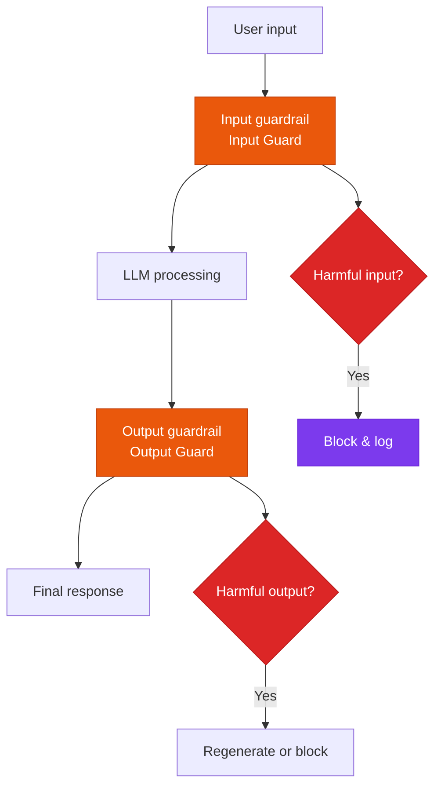

A multi-layered security strategy for blocking harmful content and preventing leaks of personal data and trade secrets.

## Multi-layered security architecture



## Input guardrails

### Prompt injection detection

```python
# Detect prompt injection attack patterns
injection_patterns = [
    r"ignore previous instructions",
    r"system prompt",
    r"you are now",
    r"jailbreak",
]

def detect_injection(user_input: str) -> bool:
    for pattern in injection_patterns:
        if re.search(pattern, user_input, re.IGNORECASE):
            return True
    return False
```

### PII detection & masking

```python
# Automatically detect and mask personal data
pii_patterns = {
    "email": r"[a-zA-Z0-9._%+-]+@[a-zA-Z0-9.-]+\.[a-zA-Z]{2,}",
    "phone": r"010[-\s]?\d{4}[-\s]?\d{4}",
    "resident_id": r"\d{6}[-]\d{7}",
}
```

## Output guardrails

### Hallucination detection

```python
# Check whether the output is grounded in the source documents
faithfulness_score = evaluate_faithfulness(
    response=llm_output,
    context=retrieved_documents
)
if faithfulness_score < 0.7:
    flag_for_review(llm_output)
```

### Content filtering categories

| Category | Handling |
|---|---|
| **Violent content** | Blocked immediately |
| **Sexual content** | Blocked immediately |
| **Hate speech** | Blocked immediately |
| **Contains personal data** | Masked, then allowed |
| **Trade secrets** | Allowed after review |
| **Medical/legal advice** | Disclaimer added |

## Open-source tool map for AI agents

Once a model can browse, call tools, run code, and act on a user's behalf, the risk goes beyond prompt injection: excessive permissions, unsafe tool use, leaked secrets and data, and malicious inputs that push an agent past its remit. The tools below are grouped by the layer of defense they cover.

### 1. Prompt injection & guardrails

*Use when untrusted external text can directly influence what the agent does.*

- **LLM Guard (Protect AI)**: Prompt-injection detection and PII leak prevention toolkit
- **NeMo Guardrails (NVIDIA)**: Dialogue-flow and programmable input/output control (Colang-based)
- **AgentGuard**: Dedicated detection of prompt and system-command injection
- **Guardian**: Prompt-injection defense and countermeasures for tool poisoning
- **Guardrails AI**: Python-based open-source guardrails framework
- **LlamaGuard**: Meta's LLM-based content-safety classifier
- **AWS Bedrock Guardrails**: Managed, cloud-based guardrails

### 2. Red teaming & security testing

*Use when you want to attack your own agent before someone else does.*

- **PyRIT (Microsoft)**: Framework for automating adversarial AI attack tests
- **garak**: LLM vulnerability scanner
- **Promptfoo**: Red teaming, safety evals, and CI/CD-integrated evaluation
- **Giskard**: Business-logic vulnerability and data-safety testing for models and agents

### 3. Identity & permissions

*Use when you need fine-grained authorization between users, agents, and APIs/tools. This is the least-privilege layer that stops an agent from issuing commands beyond what it was granted.*

- **Open Policy Agent (OPA)**: Policy-based action control (the policy-as-code standard)
- **OpenFGA**: Fine-grained authorization based on Google Zanzibar
- **Casbin**: Access-control library with multi-language support
- **Cedar (AWS)**: Authorization with a human-readable policy language

### 4. Sandboxing & runtime security

*Use when the agent executes code itself or can make irreversible changes to a real environment. The goal is to keep a dangerous command from escaping to the host OS or core servers.*

- **E2B**: Secure sandbox built for agent code execution
- **gVisor (Google)**: Isolated container runtime (user-space kernel)
- **Firecracker (AWS)**: Lightweight microVM isolation
- **Kata Containers**: Container workloads isolated by lightweight virtual machines

### 5. Data & secrets protection

*Use when the agent touches sensitive data, API keys, source code, or external dependencies.*

- **Presidio (Microsoft)**: PII detection and masking/de-identification
- **Trivy**: Vulnerability, secret, and open-source dependency scanning
- **Semgrep**: Code security scanning with custom rules for agent source
- **ModelScan**: Scans unsafe model files (e.g. Pickle) to prevent malware

### Design for defense in depth

Prompt-injection defense alone is not enough. Design these four axes together:

1. **Isolated execution environments** (sandboxing)
2. **Fine-grained access control** (identity & permissions)
3. **Credential and PII protection** (secrets & data protection)
4. **Resilience**: the system as a whole survives even when the model has been manipulated

For a longer write-up, see the blog post [AI agent security ecosystem: 20 open-source tools for 2026](/blog/ai-agent-security-ecosystem-2026/).
