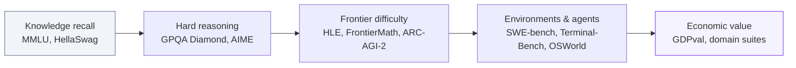
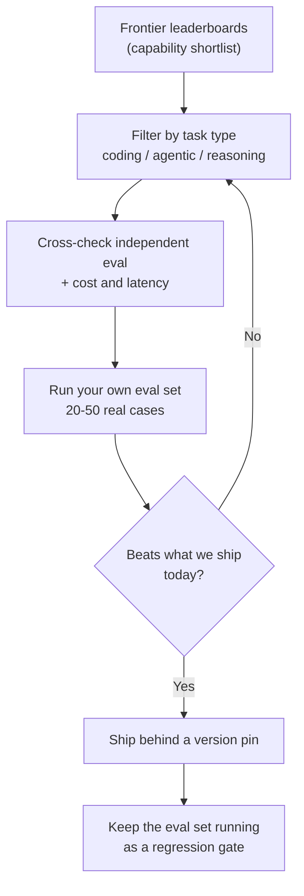

> Companion page to [AI Model Benchmarking](/docs/infrastructure/ai-model-benchmark/), which covers the composite indices used for **model and provider selection**. This page covers the **individual benchmarks** those indices are built from — what each one actually measures, how to read a leaderboard without being misled, and where evaluation is heading.

Public benchmarks and your own evaluations answer different questions, and confusing the two is the most common evaluation mistake:

| | Public benchmarks | Your own eval set |
| :--- | :--- | :--- |
| **Question answered** | Which models are worth trying at all? | Which model, prompt, and scaffold ship for *our* task? |
| **Data** | Shared, often public, sometimes in training corpora | Your inputs, your known-good outputs |
| **Decides** | The shortlist | The release |
| **Covered in** | This page | [Prompt & Context Design → Evaluation](/docs/orchestration/prompt-design/) |

A benchmark score is evidence about a model's general capability. It is never evidence that the model works for your workload.

---

## The Saturation Treadmill

Benchmarks have a life cycle. A new one separates frontier models cleanly; two years later, everyone scores in the high nineties and the differences at the top are noise. Each generation has been built to escape the ceiling of the last:

| Generation | Representative benchmarks | What broke it |
| :--- | :--- | :--- |
| **Knowledge recall** | **MMLU**, **HellaSwag**, **HumanEval** | Saturated above ~90%, and widely enough reproduced online to be assumed contaminated |
| **Hard reasoning** | **GPQA Diamond**, **AIME**, **MATH** | Frontier models now score at or above domain-expert level; the remaining gap is annotation error |
| **Frontier difficulty** | **Humanity's Last Exam**, **FrontierMath**, **ARC-AGI-2** | Deliberately built to be unsolved at release; several have moved fast anyway |
| **Environments & agents** | **SWE-bench Verified / Pro**, **Terminal-Bench**, **OSWorld**, **τ-bench** | Still the active frontier — success depends on the harness as much as the model |
| **Economic value** | **GDPval**, occupation- and industry-specific suites | Grading is expert judgement, so throughput and cost limit how fast they can grow |

A saturated benchmark is not worthless — it becomes a **regression smoke test**. A model that drops on MMLU has broken something. It just no longer ranks the top of the field.

---

## ARC-AGI — the fluid-intelligence line of benchmarks

Most benchmarks test what a model **knows**. [ARC-AGI](https://arcprize.org/) tests whether it can acquire a **new skill on the spot**: every task is a handful of input/output grid pairs illustrating a rule the model has never seen, and it must infer the rule and apply it to a held-out grid. Because each puzzle is novel by construction, memorizing the training set does not transfer — which is exactly why it stayed unsolved long after knowledge benchmarks fell.

| Version | Released | Shape of the task | Design intent |
| :--- | :--- | :--- | :--- |
| **ARC-AGI-1** | 2019 | Static grid puzzles | The original fluid-intelligence test; resisted scaling for five years, then fell to reasoning models |
| **ARC-AGI-2** | 2025 | Static grids, harder rule composition | Calibrated so that every task is solvable by at least two humans in two attempts, while frontier models started near zero |
| **ARC-AGI-3** | 2026 | Interactive game environments | Moves from one-shot answers to **exploration**: the agent must discover the rules of an unfamiliar environment by acting in it, over many turns |

Two things make ARC-AGI worth watching beyond the headline score:

- **Cost per task is reported alongside accuracy.** A system that brute-forces a puzzle with thousands of sampled programs is not doing the same thing as one that solves it in a single pass, and the leaderboard makes that visible instead of hiding it. This is the clearest mainstream example of **efficiency-normalized evaluation**.
- **A human baseline is measured, not assumed.** Tasks are validated on real people, so "AI vs. human" comparisons on ARC are grounded rather than rhetorical.

ARC-AGI-2 has since followed its predecessor up the curve — the snapshot below puts the top of that leaderboard above the benchmark's own grand-prize threshold, roughly eighteen months after release. ARC-AGI-3 is the more informative track today. It is the shift the whole field is making in miniature: from *answer this question* to *operate in this environment and figure out what the goal even is*.

---

## OSWorld 2.0 — evaluating computer use

Computer-use evaluation asks a different question from every text benchmark: not *can the model answer*, but *can an agent operate a machine*. The agent is dropped into a real virtual machine, sees screenshots, and acts with mouse and keyboard; grading is **execution-based**, meaning a validator script inspects the final state of the machine — the files written, the rows in the spreadsheet, the setting actually changed — rather than reading what the agent claimed it did.

OSWorld is the reference benchmark for this, and its three releases track how the whole field's evaluation practice has matured:

| Release | Shape | What changed |
| :--- | :--- | :--- |
| **OSWorld** (2024) | 369 tasks across Ubuntu, Windows, and macOS, in real applications | Established the format: real OS, screenshot observations, execution-based validators, binary pass/fail |
| **[OSWorld-Verified](https://xlang.ai/blog/osworld-verified)** (2025) | Same tasks, repaired | A cleanup release after audits found broken validators and unsolvable tasks — the same "**Verified**" pattern as SWE-bench Verified, and now a standard step in a benchmark's life |
| **[OSWorld 2.0](https://osworld-v2.xlang.ai/)** (2026) | 108 **long-horizon** end-to-end workflows | Tasks that take a human a median of roughly **1.6 hours**, needing hundreds of tool calls instead of the ~30 typical of 1.0 |

What makes 2.0 worth studying as an evaluation *method*, separate from its scores:

| Design choice | How it works | Why it matters |
| :--- | :--- | :--- |
| **Partial credit via checkpoints** | Around 27 task-specific checkpoints per task, instead of one pass/fail bit | Binary scoring gives the same zero to an agent that did nothing and one that completed most of a two-hour workflow but missed a final save — useless signal for improving an agent |
| **Dynamic environments** | Task-relevant emails or chat messages are injected mid-run | Tests whether the agent keeps monitoring its channels and revises a plan under new constraints, instead of treating the state it saw first as final |
| **Mostly functional checks** | Validators read environment state and output artifacts; a small minority of the score comes from model-based grading, and that portion is restricted to objective binary checklists | Keeps an LLM judge from becoming the measurement — it fills the gaps that state inspection genuinely cannot reach |
| **Explicit step budget** | Runs are reported at a fixed maximum number of steps | A step budget is a cost ceiling; without it, "success" quietly becomes a question of how long you were willing to pay |

The reason to care about the internals: **on OSWorld 2.0 the same run can be reported two ways.** At a 500-step budget, published results put the leading agents near **31% binary completion but roughly 68% partial score** — the agent gets most of the way through most workflows and then fails to finish. Both numbers are honest; quoting either without saying which is not. This single benchmark is the clearest available demonstration of why "what does this number mean" beats "whose number is higher".

For infrastructure teams, the practical cost of this style of evaluation is real: every task needs a fresh VM snapshot, isolation between runs, and a budget for hundreds of model calls per task. Running a computer-use suite internally is a platform project, not a script — which is the same conclusion the [trends section](#where-evaluation-is-heading) below reaches from the other direction.

---

## Benchmark map by capability

When a model is announced, the scores quoted are chosen by the vendor. This is the fuller map to check against:

| Capability | Benchmarks in use | Notes |
| :--- | :--- | :--- |
| **Knowledge & reasoning** | **GPQA Diamond**, **Humanity's Last Exam**, **MMLU-Pro** | HLE spans 100+ subjects with expert-written questions; a large fraction is multimodal |
| **Math** | **FrontierMath**, **AIME**, **MathArena** | FrontierMath is held privately and tiered by difficulty; MathArena scores competitions *after* the model's cutoff to avoid contamination |
| **Abstraction** | **ARC-AGI-2 / -3** | Novel-task reasoning rather than recall — see above |
| **Coding** | **SWE-bench Verified**, **SWE-bench Pro**, **FrontierSWE**, **LiveCodeBench**, **SciCode** | Verified is the human-filtered subset of SWE-bench; LiveCodeBench rotates in fresh problems continuously |
| **Terminal & tools** | **Terminal-Bench**, **τ-bench** | Deterministic grading via exit codes, file diffs, and output matching |
| **Computer use** | **OSWorld 2.0**, **OSWorld-Verified**, **WebArena** | The agent drives a real desktop or browser from screenshots, graded on machine state — see above |
| **Long context** | **AA-LCR**, **GraphWalks**, needle-and-reasoning variants | Retrieval over long inputs is largely solved; *reasoning* across the whole input is not — GraphWalks BFS is a clean test of the difference, since it requires following edges through the context rather than finding one passage |
| **Hallucination** | **AA-Omniscience**, **SimpleQA** | Score both what the model gets right and what it asserts wrongly — see [Guardrails & Security](/docs/governance/guardrails/) |
| **Business operations** | **Vending-Bench 2**, **AutomationBench** | Long-horizon coherence in a simulated business, and cross-application workflow orchestration graded on final state — see the [five-model snapshot](#reading-the-table) below |
| **Multimodal understanding** | **Chartography**, **Blueprint-Bench 2** | Newer suites with little public documentation; read the provenance notes before quoting them |
| **Cybersecurity** | **ExploitGym**, **SEC-bench Pro**, **CWE-bench** | Whether an agent can find, exploit, or patch real vulnerabilities — a capability score and a misuse-risk signal at once |
| **Economic value** | **GDPval** | 1,300+ tasks drawn from the real deliverables of 44 occupations across nine industries, graded by professionals against expert-produced work |

---

## Snapshot — where the numbers stood in September 2026

Scores below were compiled on **2026-09-06** from the public leaderboards linked in each row. They are included to show the *shape* of the field, not as a citable ranking: frontier numbers move weekly, aggregators disagree, and the entry at the top of any row will likely be stale by the time you read it. Follow the link before quoting a figure.

| Benchmark | Leading result | Runners-up | As of / source |
| :--- | :--- | :--- | :--- |
| **ARC-AGI-2** | GPT-6 Astra — **95.0%** | GPT-5.6 Sol 92.5%, Claude Opus 5 90.4% | Sep 3, 2026 — [BenchLM](https://benchlm.ai/benchmarks/arc-agi-2), [llm-stats](https://llm-stats.com/benchmarks/arc-agi-v2) |
| **ARC-AGI-3** | GPT-6 Astra — **62.7%** | Claude Opus 5 30.2%, GPT-5.6 Sol 7.8% | Sep 4, 2026 — [BenchLM](https://benchlm.ai/benchmarks/arcagi3), [ARC Prize](https://arcprize.org/leaderboard) |
| **Humanity's Last Exam** | Claude Fable 5.1 — **65%** (tool-assisted boards) down to **46.5%** (no tools, text only) | Claude Opus 5 64.7%, Claude Mythos 5 64.5% | Sep 4–5, 2026 — [BenchLM](https://benchlm.ai/benchmarks/hle), [Artificial Analysis](https://artificialanalysis.ai/evaluations/humanitys-last-exam), [llmrun](https://llmrun.dev/benchmark/hle) |
| **FrontierMath v2 (Tier 4)** | GPT-6 Astra — **97.6%** | GPT-5.6 Sol 83.0%, GPT-5.6 Terra 68.3% | Sep 4, 2026 — [BenchLM](https://benchlm.ai/benchmarks/frontiermathv2tier4), [Epoch AI](https://epoch.ai/benchmarks/frontiermath-tier-4-v2) |
| **SWE-bench Verified** | Claude Opus 5 — **96%** | Claude Mythos 5 95.5%, Claude Fable 5 95% | Sep 2–4, 2026 — [BenchLM](https://benchlm.ai/benchmarks/swe-bench-verified), [llm-stats](https://llm-stats.com/benchmarks/swe-bench-verified) |
| **SWE-bench Pro** | Claude Fable 5.1 — **81.2%** | — | 2026 — [CodingFleet](https://codingfleet.com/blog/swe-bench-pro-leaderboard-2026/) |
| **Terminal-Bench 2.0** | GPT-5.6 Sol — **91.9%** | Claude Mythos 5 88.0%, GPT-5.6 Terra 87.4% | Sep 2026 — [BenchLM](https://benchlm.ai/benchmarks/terminal-bench-2), [tbench.ai](https://www.tbench.ai/leaderboard/terminal-bench/2.0) |
| **OSWorld 2.0** | GPT-6 Astra — **72.6%** | Claude Opus 5 70.6%, Muse Spark 1.3 66.9% | Sep 4, 2026 — [BenchLM](https://benchlm.ai/benchmarks/osworld2), [Snorkel AI](https://snorkel.ai/leaderboard/os-world-2-0/) |
| **OSWorld 2.0** (same benchmark, reported as binary vs. partial at a 500-step budget) | Claude Opus 5 — **31.4%** binary / **68.3%** partial | GPT-5.6 Sol 27.3% / 62.7% | 2026 — [Snorkel AI](https://snorkel.ai/blog/osworld-2-0-why-computer-use-agents-fail-most-tasks/) |
| **OSWorld-Verified** | Qwen3.8 Max — **86.1%** | Claude Fable 5 85%, Claude Mythos 5 85% | Sep 4, 2026 — [BenchLM](https://benchlm.ai/benchmarks/osworld-verified), [Steel.dev](https://leaderboard.steel.dev/leaderboards/osworld/) |
| **GDPval** | GPT-5.2 — **70.9%** win+tie vs. expert deliverables (49.7% outright wins) | GDPval-AA Elo: Claude Opus 5 1862, Claude Fable 5.1 1853 | 2026 — [Epoch AI](https://epoch.ai/benchmarks/gdpval), [Artificial Analysis](https://artificialanalysis.ai/evaluations/gdpval-aa) |

Four things this table shows better than any argument:

- **The treadmill is fast.** ARC-AGI-2 was built in 2025 to be near-zero for models and is now above its own 85% grand-prize threshold, against an average individual human score of 66%. FrontierMath Tier 4 — the hardest tier of a benchmark designed to last — reads the same way at the top.
- **Protocol matters more than model at the top.** Humanity's Last Exam spans roughly 46% to 65% *for the same model family*, depending on whether search, browsing, and code execution are allowed. A number without its protocol is not a result.
- **Aggregators disagree.** SWE-bench Verified appears as 96% or 97% depending on whose harness ran it, and the top several models sit within about one point — inside the noise of the harness itself.
- **The unsaturated benchmarks are the interactive ones.** ARC-AGI-3 and long-horizon computer use still have real headroom — on OSWorld 2.0, agents finish under a third of the workflows outright even while scoring around 70% on partial credit, and the gap between first and second place there dwarfs anything on the coding leaderboards.

---

## Snapshot — a five-model comparison on the newest suites (October 2026)

The September snapshot above follows single benchmarks across public leaderboards. This one is a different kind of artifact: **one table, seventeen benchmarks, eight capability areas, assembled by whoever made the chart.** It is worth reading twice — once for the numbers, once for how the table is built.


**Provenance.** This table reached the site author as an image. It names no publisher, date, or measurement conditions, and its top edge is cropped, so any footnote is not visible. The highlighted Gemini 4 Carbon column and its lead on 15 of 17 rows are consistent with a vendor launch chart, which would make the figures self-reported — that is an inference from the layout, not something the image states. Searches for independent results on these benchmarks found none for Gemini 4 Carbon and none for GPT-6 Astra, so treat every figure as unverified. Transcribed 2026-10-31; bold marks the best score in each row.


| Area | Benchmark · condition | Gemini 4 Carbon | Gemini 4 Argon | GPT-6 Astra | Claude Opus 5.5 | Claude Fable 5.1 |
| :--- | :--- | ---: | ---: | ---: | ---: | ---: |
| **Overall capability** | **AA Index v5.0** | **59** | 50 | 57 | 58 | 49 |
|  | **Vals Index v2.2** | **70.4%** | 69.2% | 65.0% | 70.2% | — |
| **Agentic coding** | **SWE-sweep** | **9.6%** | 4.3% | 9.5% | 3.6% | 2.9% |
|  | **FrontierSWE 2** | 61.2% | 55.0% | **65.5%** | 62.3% | 56.3% |
|  | **Terminal-Bench 4.0 (AA)** | **65.2%** | 57.1% | 59.1% | 59.6% | 52.0% |
| **Computer use** | **Agents' Last Exam v1.1** · score | **77.4%** | 69.0% | 73.1% | 71.6% | — |
|  | **OSWorld-2.1** · offline subset | 81.5% | 74.7% | 80.9% | **87.2%** | 76.8% |
| **Knowledge work** | **AutomationBench** · Zapier | **53.9%** | 51.3% | 41.4% | 42.5% | 31.4% |
|  | **Vending-Bench 2** · ending balance, USD | **$16,484** | $13,718 | $15,515 | $9,235 | $5,422 |
| **Multimodal understanding** | **Chartography** | **72.5%** | 71.6% | 71.0% | 66.3% | 46.2% |
|  | **Blueprint-Bench 2** · similarity | **58.6%** | 54.4% | 49.7% | 51.2% | 41.9% |
| **Long-context reasoning** | **GraphWalks** · 256k–1M, BFS F1 | **96.2%** | 84.2% | 71.8% | 66.8% | 65.0% |
| **Science & math** | **RiemannBench** | **80.0%** | 76.0% | 72.0% | 69.6% | 65.6% |
|  | **Terminal-Bench-Science 0.1 (AA)** | **64.8%** | 52.9% | 63.3% | 59.0% | 43.3% |
| **Cybersecurity** | **CWE-bench** · patching | **71.0%** | 68.0% | 68.0% | 67.0% | 58.0% |
|  | **ExploitGym** · exploitability verification | **54.8%** | 42.0% | 42.4% | 34.5% | — |
|  | **SEC-bench Pro** · vulnerability detection | **88.2%** | 83.4% | 85.4% | — | — |

### Reading the table

- **Fifteen of seventeen rows go to Gemini 4 Carbon, but several of those leads are thin.** On four rows the margin is a point or less — SWE-sweep (+0.1), Vals Index (+0.2), Chartography (+0.9), AA Index (+1) — small enough that a different harness or a rerun could reorder them. The gaps large enough to matter are ExploitGym (+12.4 over the next model), GraphWalks (+12.0), Terminal-Bench 4.0 (+5.6), and Agents' Last Exam (+4.3).
- **The two rows it trails are the two the chart itself highlights:** FrontierSWE 2, where GPT-6 Astra leads 65.5% to 61.2%, and the OSWorld-2.1 offline subset, where Claude Opus 5.5 leads 87.2% to 81.5%.
- **The newest suites are the ones with headroom.** SWE-sweep tops out at 9.6%, AutomationBench at 53.9%, ExploitGym at 54.8%. On Vending-Bench 2 the best ending balance is $16,484, against Andon Labs's own estimate that roughly $63K is achievable over the simulated year — the leader is nowhere near the ceiling.
- **Benchmarks get harder by versioning, and the version is part of the score.** Nine of the seventeen rows carry a version or revision in their name. The September snapshot has Terminal-Bench 2.0's leader at 91.9%; the best score on Terminal-Bench 4.0 here is 65.2% — a harder test, not a worse model, and likely a different harness, since "(AA)" presumably marks Artificial Analysis's own run. Going the other way, the OSWorld-2.1 offline subset tops out at 87.2% while the OSWorld 2.0 leader above sits at 72.6%: a subset of a newer revision, not the same test. A score without its benchmark, version, subset, and harness is not reproducible.
- **The comparison set is the chart author's choice.** Models that lead rows elsewhere on this page — GPT-5.6 Sol, Claude Mythos 5, Claude Opus 5 — are not in the table. Five cells are also blank, four of them for Claude Fable 5.1; a dash means *not reported*, not zero.
- **Reasoning effort is part of the result, and the table does not state it.** An article citing a different version of the Artificial Analysis index (v4.3.2) reports [Gemini 4 Argon at 52.56 on high effort and Claude Opus 5.5 at 57.62 at max effort](https://www.orcarouter.ai/pt/blog/gemini-4-vs-claude-opus-5-5) — the same model scores differently at different settings. The table's 50 and 58 for those two models are in the same order at a different version, which is mildly reassuring and proves nothing. The source is an aggregator, so weigh it accordingly.

### What the newer suites measure

For nine of the seventeen rows, no primary description could be found. That is worth knowing before quoting them: a score on a benchmark whose task, grader, and subset you cannot read is a number, not evidence.

| Benchmark | What it measures | What could be verified |
| :--- | :--- | :--- |
| **AA Index v5.0**, **Vals Index v2.2** | Composite scores from two independent evaluators | The [AI Model Benchmarking](/docs/infrastructure/ai-model-benchmark/) page describes Intelligence Index v4.0; scores do not carry across versions |
| **SWE-sweep** | Listed as a coding and agentic benchmark | Aggregator listing only, and it flags its own results as unreliable — [BenchmarkList](https://benchmarklist.com/benchmarks/swe_sweep/) |
| **FrontierSWE 2** | Hard, long-horizon software-engineering tasks from real technical domains; v2 is listed as 34 ultra-long-horizon engineering and research tasks, five trials each | [GitHub](https://github.com/Proximal-Labs/frontier-swe) and [Epoch AI](https://epoch.ai/benchmarks/frontierswe); the task count comes from an aggregator ([BenchmarkList](https://benchmarklist.com/benchmarks/frontierswe_v2/)) |
| **Terminal-Bench 4.0 (AA)** | Successor to the terminal-task benchmark covered above as Terminal-Bench 2.0 | Version number only; no primary description found |
| **Agents' Last Exam v1.1** | Grouped under computer use in the table | Nothing found |
| **OSWorld-2.1 · offline subset** | Descends from the OSWorld line — see the OSWorld 2.0 section above | No description of 2.1, or of what "offline" excludes, found |
| **AutomationBench** | Zapier's test of cross-application workflow orchestration: the agent discovers REST API endpoints (about 500 across 47 apps) and is graded only on the final state of the simulated apps | [arXiv 2604.18934](https://arxiv.org/abs/2604.18934) |
| **Vending-Bench 2** | Andon Labs's simulation of running a vending business for a year, testing long-term coherence against adversarial suppliers; scored here as ending account balance | [Andon Labs](https://andonlabs.com/evals/vending-bench-2) |
| **Chartography** | The name suggests chart reading | Nothing found |
| **Blueprint-Bench 2** | The table scores it as a similarity measure | Nothing found |
| **GraphWalks** | OpenAI's benchmark: run a breadth-first search over a graph described in a very long prompt, scored as set-F1 over the returned node IDs. BFS tasks need intermediate steps, unlike the retrieval-like "parents" tasks. Prompts and solutions are public, so contamination is a standing concern | [Epoch AI review](https://epoch.ai/benchmarks/graphwalks/review) |
| **RiemannBench** | Grouped under science and math in the table | Nothing found |
| **Terminal-Bench-Science 0.1 (AA)** | Version 0.1 marks an early release | Nothing found |
| **CWE-bench · patching** | The table scores it on patching | Listing page only — [BenchmarkList](https://benchmarklist.com/benchmarks/cwe_bench/) |
| **ExploitGym** | Whether an agent can extend a vulnerability trigger into a working exploit: 898 instances from userspace programs, the V8 engine, and the Linux kernel, with configurable defenses | [arXiv 2605.11086](https://arxiv.org/abs/2605.11086) |
| **SEC-bench Pro** | Extends SEC-bench to long-horizon security tasks on JavaScript engines: 183 validated instances (103 V8, 80 SpiderMonkey). The table labels it vulnerability detection while the paper frames the tasks more broadly — check which task type a score covers | [arXiv 2605.26548](https://arxiv.org/abs/2605.26548) |

If you copy a number from a chart like this into a decision, copy its benchmark, version, subset, harness, and reasoning-effort setting beside it — and re-run the part that matters on your own tasks.

---

## Reading a leaderboard without being fooled

| Trap | What it looks like | What to do |
| :--- | :--- | :--- |
| **Contamination** | A model scores far better on a public benchmark than on its private variant | Prefer rotating or post-cutoff benchmarks (**LiveCodeBench**, **MathArena**, current-year **AIME**) |
| **Harness variance** | The same model posts very different agentic scores in different reports | Check the scaffold: tool set, retry budget, context length. On agentic benchmarks the harness is part of the result |
| **pass@k inflation** | An impressive number that turns out to be best-of-many attempts | Compare `pass@1` to `pass@1`, and check how many attempts each cell averages |
| **Overlapping confidence intervals** | Ranks 1–3 separated by a few points | On preference arenas, differences smaller than the CI are noise, not ranking |
| **Self-reported scores** | Vendor-run evaluation with an unspecified setup | Cross-check against an independent evaluator such as [Artificial Analysis](https://artificialanalysis.ai/) |
| **Cost blindness** | A top score achieved with enormous per-task compute | Read accuracy together with cost and latency, the way ARC-AGI reports it |
| **Private benchmarks** | Held-out sets that cannot be independently reproduced | They resist contamination but require trusting the maintainer — treat them as one signal, not the signal |
| **Vendor-chosen comparison** | A launch chart in which the vendor's own model leads nearly every row | The author picked both the rivals and the benchmarks; check who and what was left out, and which rows the vendor does *not* lead |
| **Version and subset labels** | "OSWorld-2.1 · offline subset", "Terminal-Bench 4.0 (AA)" | The unit being scored is benchmark + version + subset + harness; never compare across any of them |
| **Blank cells** | A dash where a model's score should be | It means *not reported*, not zero — and an uneven pattern of blanks changes what the rows can be compared on |

The practical rule is **triangulation**: a static academic benchmark, a human-preference arena, and an agentic suite. Where all three agree, the ranking is probably real. Where they disagree, the disagreement is usually the interesting information.

---

## Where evaluation is heading

| Trend | What is changing | Why it matters for infrastructure |
| :--- | :--- | :--- |
| **From questions to environments** | Benchmarks ship as runnable environments — a repo, a shell, a desktop, a customer-service simulator — rather than a list of prompts | Evaluation now needs sandboxes, container orchestration, and per-run isolation; running an agentic suite is an infrastructure project, not a script |
| **From accuracy to efficiency** | Cost, tokens, and wall-clock time are reported next to the score | Matches how models are actually chosen in production, where a 2-point gain rarely justifies a 10× cost |
| **From single-turn to long-horizon** | Tasks measured in hours of agent work, with partial credit and checkpoints — OSWorld 2.0 workflows take a human about 1.6 hours and hundreds of agent tool calls | Reliability compounds: a 95%-per-step agent finishes a 50-step task less than one time in ten |
| **From static to live** | Continuously refreshed problem sets and post-cutoff competitions | Contamination resistance becomes a property of the benchmark's operating model, not its content |
| **From capability to value** | **GDPval**-style evaluation against real professional deliverables | Connects model choice to [business impact](/docs/business/) rather than to a score with no unit |
| **From helpfulness to risk-relevant capability** | Security suites such as ExploitGym measure whether an agent can turn a vulnerability into a working exploit | They quantify what a model could do if misused as well as what it can do for a security team, so they inform [guardrails and governance](/docs/governance/guardrails/) decisions, not only model selection |
| **Goodhart pressure** | Benchmarks with verifiable rewards are also excellent RL training targets | A benchmark used for training stops measuring generalization; held-out and rotating sets are the only defense |

---

## Applying this in practice

### Checklist

- [ ] Identify which two or three benchmarks actually correspond to your workload — ignore the rest of the announcement
- [ ] Confirm the score is `pass@1` under a harness comparable to the one you will run
- [ ] Record the benchmark, version, subset, harness, and reasoning-effort setting next to every score you copy into a document
- [ ] Check the same model on an independent evaluator, not only the vendor's own numbers
- [ ] Read cost and latency alongside accuracy before shortlisting
- [ ] Verify against a contamination-resistant benchmark if the task resembles a well-known public dataset
- [ ] Replace the leaderboard with your own eval set before the release decision
- [ ] Re-run that eval set on every model and prompt version change — see [Prompt & Context Design](/docs/orchestration/prompt-design/)

---

## Related Categories

- [📊 AI Model Benchmarking](/docs/infrastructure/ai-model-benchmark/) — composite indices, provider comparison, openness
- [⚙️ Model Selection & Tuning](/docs/infrastructure/model-selection/) — turning a shortlist into a deployed model
- [🛡 AI Governance Overview](/docs/governance/) — hallucination monitoring and regulatory evidence
