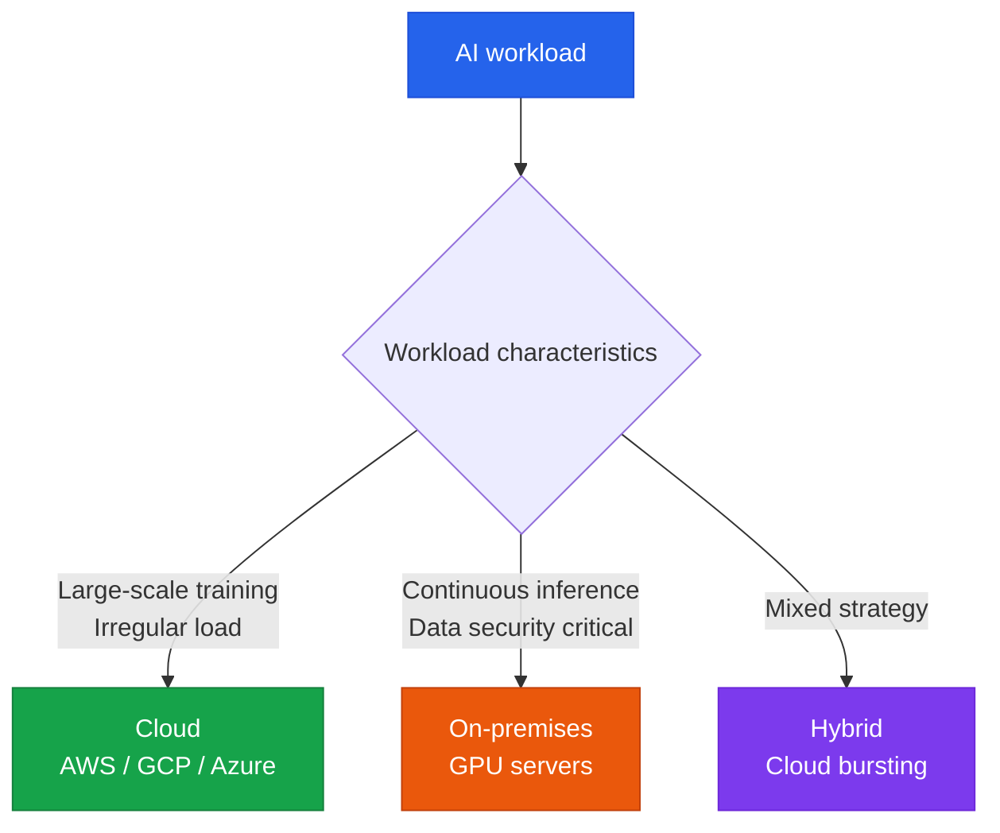

Strategies for cost-efficient operation of GPU/NPU servers and cloud infrastructure

## On-Premises vs. Cloud



## Cloud AI Service Comparison

| Item | AWS Bedrock | Google Vertex AI | Azure AI |
|---|---|---|---|
| **Key models** | Claude, Llama, Titan | Gemini, PaLM | GPT-4, Phi |
| **Fine-tuning** | Supported | Supported | Supported |
| **On-demand pricing** | Per-token billing | Per-token billing | Per-token billing |
| **Provisioned throughput** | Supported | Supported | Supported |

## Cost Optimization Strategies

### 1. Model Tiering

```
Complex tasks   → Large models (Claude Opus, GPT-4o)
General tasks   → Mid-size models (Claude Sonnet, GPT-4o-mini)
Simple tasks    → Small models (Claude Haiku, GPT-3.5)
```

### 2. Caching Strategy

For prompts or context that are reused repeatedly, **prompt caching** can cut costs by up to 90%.

### 3. Batch Processing

For workloads that don't require a real-time response, using the **Batch API** cuts costs by 50%.

## GPU Spec Guide

| Use case | Recommended GPU | Notes |
|---|---|---|
| **Large-scale training** | H100, A100 | 80GB+ VRAM |
| **Mid-size fine-tuning** | A10G, L40S | 24–48GB VRAM |
| **Inference server** | T4, L4 | 16GB VRAM, cost-efficient |
| **Local development** | RTX 4090 | 24GB VRAM |

## Managed Platforms vs. Self-Hosting

Before sizing a GPU, decide whether you should be holding one at all. There are three tiers, and they differ in what you own rather than in what the model can do:

| Tier | You own | Provider owns | Billing |
|---|---|---|---|
| **Managed model API** | Prompts, retrieval, application code | Models, capacity, scaling, patching | Per token, or provisioned throughput |
| **Managed ML platform** | Data, training code, model artifacts, endpoint config | Notebooks, training fleet, endpoint infrastructure | Per instance-hour, training and inference billed separately |
| **Self-hosted serving** | Everything, down to the CUDA version | Nothing | The GPUs, whether or not traffic arrives |

The two AWS entries in the comparison above sit in different tiers, and conflating them is a common planning mistake:

- **Amazon Bedrock** is the managed model API tier — a single interface over foundation models from several providers, with no infrastructure to run. Its adjacent features are the ones you would otherwise assemble yourself: managed knowledge bases for [RAG](/docs/orchestration/rag/), agent orchestration, and [Bedrock Guardrails](/docs/governance/guardrails/) for input and output filtering. Google Vertex AI and Azure AI occupy the same tier.
- **Amazon SageMaker** is the managed ML platform tier — an end-to-end environment for building, training, and deploying models you own, including classical ML on tabular data, not only foundation models. You choose the instance types and the endpoint stays up until you take it down.

A useful default: start on the managed API tier, because it turns a capacity problem into a line item. Move to a platform or to self-hosting only when a concrete requirement forces it — data residency, a model no provider hosts, a fine-tune you must own, or a sustained load where per-token pricing has become more expensive than the hardware.

## Serving Open Models

Self-hosting a model means running an inference server, and the serving engine decides how much of the GPU you actually get to use. On identical hardware, throughput differs by an order of magnitude between a naive request loop and a batching engine.

| Engine | Best fit |
|---|---|
| **vLLM** | High-throughput production serving — PagedAttention plus continuous batching |
| **TensorRT-LLM** | Lowest latency on NVIDIA hardware, at the cost of a compile step per model |
| **TGI** (Text Generation Inference) | Production serving inside a Hugging Face-centric stack |
| **Ollama / llama.cpp** | Local development, CPU and consumer-GPU inference |

The levers that decide throughput:

- **Continuous batching** — arriving requests join the running batch instead of waiting for it to drain
- **KV cache management** — paged attention lets many concurrent sequences share VRAM without pre-reserving worst-case space
- **Tensor parallelism** — split a model across GPUs once the weights exceed one card
- **Quantization** — buys VRAM headroom, and therefore concurrency, in exchange for some quality; see [Model Selection & Tuning](/docs/infrastructure/model-selection/)

### Inside the serving loop — prefill, decode, and the memory wall

The levers above only make sense once you see that inference runs in two phases with completely different bottlenecks:

| Phase | What it does | Bound by |
|---|---|---|
| **Prefill** | Processes the whole prompt at once to produce the first token, computing attention over every input position in parallel | **Compute** — large matrix multiplications saturate the GPU's math units |
| **Decode** | Generates one token per step, each step attending over everything so far | **Memory bandwidth** — a single token's worth of math requires reading the entire model's weights plus the KV cache |

This asymmetry is why batching is the central optimization. During decode the GPU spends most of its time waiting on memory, so adding more sequences to the in-flight batch costs almost nothing in extra time — the weights were being read anyway. Throughput scales with batch size until VRAM or bandwidth runs out, which is the order-of-magnitude difference between a request loop and a batching engine.

**Continuous (in-flight) batching** is what makes this usable with real traffic: instead of forming a batch and waiting for every sequence in it to finish, the engine admits an arriving request into the running batch at the next step and evicts finished sequences immediately. Without it, one long generation holds the whole batch hostage and short requests inherit its latency.

### KV cache — the dominant consumer of VRAM

The [KV cache](/docs/infrastructure/models/transformer/) is what makes decoding tractable: keys and values for earlier tokens are stored instead of recomputed. The cost is memory, and it is not a rounding error:

```
KV bytes per token ≈ 2 (K and V) × layers × kv_heads × head_dim × bytes_per_element
total ≈ (KV bytes per token) × sequence_length × concurrent_sequences
```

Model weights are a fixed cost you pay once. The KV cache is a per-request cost that grows linearly with context length *and* with concurrency — so in long-context serving it, not the weights, is what decides how many users fit on the card. Three techniques manage it:

| Technique | Mechanism | What it buys |
|---|---|---|
| **PagedAttention** | Allocates the cache in fixed-size blocks, like OS paging, instead of one contiguous worst-case reservation per sequence | Near-zero fragmentation and far higher concurrency — a sequence only holds blocks it has actually filled |
| **Prefix / prompt caching** | Recognizes a shared leading prefix across requests and reuses its computed cache instead of re-prefilling it | A large cut in **TTFT** and prefill compute for repeated system prompts or documents — the same mechanism behind [prompt caching](/blog/prompt-caching/) in hosted APIs and behind [CAG](/docs/orchestration/rag/) |
| **Eviction, offload, and recompute** | Under pressure, a sequence's cache is dropped and recomputed later, or paged out to host memory over PCIe | Survival instead of an OOM — but recompute costs prefill compute and offload costs bandwidth, so both show up as a latency spike |

### Admission control — refusing work on purpose

Because decode is memory-bound and VRAM is finite, an inference server that accepts everything handed to it does not degrade gracefully: it either hits OOM or collapses into a queue where every request misses its latency target. Admission control is the entry gate that prevents this, and it is the piece most teams discover they need only after an incident.

The mechanism is to estimate a request's memory footprint *before* admitting it — prompt tokens plus the maximum new tokens it may generate, converted into KV blocks — and compare that against what is actually free:

| Signal | Action |
|---|---|
| Free KV blocks comfortably cover the request | **Admit** into the running batch |
| Capacity is tight but the request is small or can wait | **Queue** it, with a bounded queue and a deadline |
| The queue is already at its latency budget | **Reject** fast (HTTP 429) — a quick refusal is a better answer than a timeout |
| The request alone would not fit at all | **Degrade or refuse** — cap `max_tokens`, or route it to a longer-context tier |

Two rules follow. An unbounded queue is a latency bomb, not a safety net — it converts a capacity problem into a timeout problem further downstream. And the decision belongs as close to the edge as possible: shedding load at the gateway is cheaper than shedding it after the prefill has already consumed GPU time.

A deployment with zero rejections and a rising TTFT is not a healthy one — it is one that chose the timeout. The metrics that make this visible are in the table below.

### Where inference runs — separate server or in-process

Serving an open model does not have to mean a separate service. Two topologies are in use, and the trade is infrastructure complexity against control over batching:

| Topology | How it works | Fits |
|---|---|---|
| **Separate inference server** | A dedicated process or cluster (vLLM, TGI, TensorRT-LLM) that applications call over HTTP or gRPC | Multi-tenant workloads, where batching across *all* clients is exactly what you want, and the GPU fleet scales independently of the app |
| **Embedded in-process** | Inference is linked into the application process through bindings to a native runtime such as `llama.cpp`, with no network hop | Local, edge, desktop, and single-tenant workloads — one deployable artifact, no serving tier to operate, and no inter-service latency |

The embedded pattern has become practical outside Python. [Kronk](https://github.com/ardanlabs/kronk), from Ardan Labs, is a Go SDK that integrates `llama.cpp`, `whisper.cpp`, and `stable-diffusion.cpp` directly into a Go application for hardware-accelerated local inference, with an OpenAI-shaped API, and it also ships a model server for headless use. Its maintainers describe the SDK — rather than the bundled server — as the point, and a path toward one-binary deployment as the direction of travel; check the repository for where that currently stands.

The trade-off is worth being explicit about, because it is the same trade in both directions: once inference lives inside your process, **continuous batching and admission control become your application's problem**, not an engine's. For a single-user desktop tool that is a non-issue and the removed infrastructure is pure gain. For a shared multi-tenant service, those are exactly the mechanisms you would be re-implementing, and a serving engine already has them.

What to hold a serving deployment to:

| Metric | What it tells you |
|---|---|
| **TTFT** (time to first token) | Perceived responsiveness — driven by prompt length and queue depth |
| **Inter-token latency** | How smooth the stream feels once generation starts |
| **Throughput** (aggregate tokens/sec) | What the GPU is actually returning for its cost |
| **Concurrency at target latency** | The number that sizes the fleet — peak throughput at an unacceptable TTFT is not capacity |
| **Queue wait time** | How long admitted requests sit before the batch takes them — the first thing to move when capacity runs short |
| **Rejection rate** | Load deliberately shed by admission control; zero rejections under pressure means the queue is absorbing it instead |
| **KV cache utilization** | How close the cache is to full — the ceiling on concurrency, and the trigger for eviction or offload |
