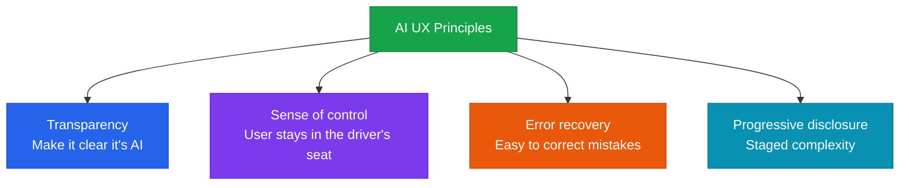
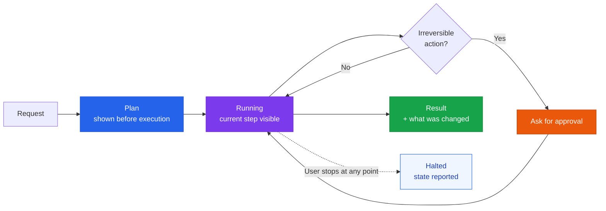

Design principles for conversational user interfaces (CUI) and AI-specific UX patterns

## Core principles of AI UX



## Designing conversational user interfaces (CUI)

### Streaming responses

Use **streaming** so users don't feel like they're waiting around while the AI "thinks."

```python
# Claude API streaming example
with anthropic.messages.stream(
    model="claude-sonnet-4-6",
    max_tokens=1024,
    messages=[{"role": "user", "content": prompt}]
) as stream:
    for text in stream.text_stream:
        print(text, end="", flush=True)
```

### Managing loading states

| State | UX treatment | Example |
|---|---|---|
| **Simple query** (< 3 sec) | Show a spinner | Keyword search |
| **Complex analysis** (3-10 sec) | Show progress messages | "Analyzing..." |
| **Long-running task** (> 10 sec) | Show step-by-step progress | "Step 1/3 complete" |

## Designing for agent runs

The loading states above assume the AI is composing an answer. An agent is doing something else: it is taking actions, in sequence, that change state outside the conversation. A slow answer costs patience; a wrong action costs work. That difference is what the interface has to carry.



### The four obligations

| Obligation | What the interface shows | Why it matters |
|---|---|---|
| **Plan before running** | The steps the agent intends to take, before the first one executes | The cheapest moment to correct a misunderstanding is before anything happened |
| **Progress during** | The current step and what it is doing, not a spinner | A run measured in minutes with no visible state is indistinguishable from a hang |
| **Interruption** | A stop control that works at any point, and says what was already done | Without it, the only way to stop a wrong run is to close the tab and hope |
| **Approval before irreversible actions** | A confirmation naming the specific action and its target | Undo does not exist for a sent email or a deleted record |

### Calibrating approval

Confirming everything trains users to click through confirmations, which is worse than not asking. Tier the actions instead:

| Tier | Examples | Treatment |
|---|---|---|
| **Auto** | Reading files, searching, querying | Run freely; log it in the step list |
| **Notify** | Creating a draft, writing to a scratch branch, staging a change | Run, then show what happened with an undo affordance |
| **Confirm** | Sending a message, charging, deleting, deploying, anything touching production | Block on explicit approval, naming the target |

The tier follows reversibility, not risk in the abstract. "Delete a file" is Confirm in a user's documents and Auto in a scratch directory — the same action, different blast radius. For the server-side version of this boundary, see the [human-in-the-loop pattern](/docs/orchestration/workflow-automation/).

### Making progress legible

A step list is only useful if the steps are named in the user's terms. `Executing tool call 3/7` tells the user nothing they can act on; `Searching the policy archive for refund terms` tells them whether the agent understood the request — which is the decision they are actually there to make.

Three details decide whether a long run feels controlled:

- **Show the step, not the internals** — the tool name is implementation; the intent is what the user can judge
- **Keep completed steps visible** — when a run ends badly, the question is always *where* it went wrong, and a cleared log cannot answer it
- **Report state on stop** — "stopped after step 3 of 7; the first two edits were applied, the third was not" is the difference between a halt and an unknown

### When the run outlives the session

A run you can close the laptop on has stopped being conversational UI and become a job. Jobs need a durable record, a status the user can return to, and a notification when they finish or need input. If an agent's work can span hours — see [durable execution](/docs/orchestration/agent-interface/#reference-stack) — the interface owes a place to check on it that is not the chat thread.

## AI-specific UX patterns

### 1. Indicating uncertainty

Make it clear to users when the AI isn't confident in its answer.

```
✅ "Based on what I could verify, it's ~. Please check the official site for the latest information."
❌ "It's ~." (stating uncertain information as if it were certain)
```

### 2. Editable AI output

Let users edit or regenerate AI output themselves.

```
[AI-generated text]
  ↓ buttons
[Edit] [Regenerate] [View other version]
```

### 3. Showing sources

In RAG-based systems, show where an answer's information came from.

```
Answer: "Returns are accepted within 30 days of purchase."
Source: [Customer Service Policy v3.2] (click to view the original)
```

## Anti-patterns to avoid

- **AI washing**: dressing up non-AI features as if they were AI
- **Over-anthropomorphization**: portraying AI as human-like in a way that induces excessive trust
- **Forced conversation**: forcing a simple search into a chat interface unnecessarily
- **Opaque AI**: hiding what information the AI based its answer on
- **Silent agency**: an agent taking actions with side effects without showing what it did
- **Confirmation fatigue**: prompting for approval on everything, which turns the one confirmation that mattered into another reflexive click
