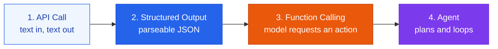
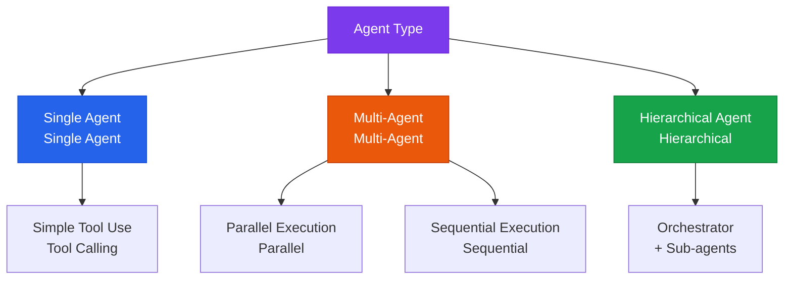
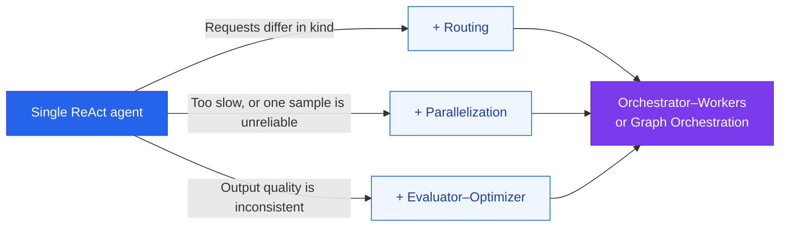
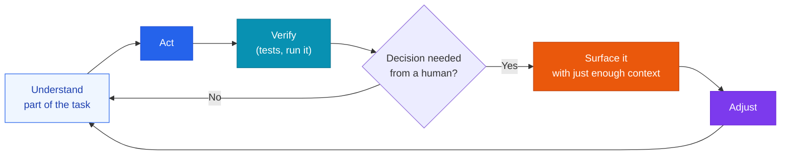

Integrating external tools (APIs), multi-agent collaboration, and execution control

## From API Call to Agent

An agent is not a separate product category — it is what you get after three additions to a plain API call. Each step widens what the model is allowed to do.



### Structured Outputs

Prose is fine for a chat window and useless to the calling code. Pin the response to a schema so downstream code can consume it without parsing free text:

```python
# Declare the shape you expect, not the wording
schema = {
    "type": "object",
    "properties": {
        "sentiment": {"type": "string", "enum": ["positive", "neutral", "negative"]},
        "priority": {"type": "integer", "minimum": 1, "maximum": 5},
        "summary":  {"type": "string", "maxLength": 200},
    },
    "required": ["sentiment", "priority", "summary"],
}
```

- **Constrain enums rather than asking for a word** — an `enum` removes the whole class of "Positive!" vs `"positive"` mismatches
- **Validate before you trust** — even schema-constrained output should be validated at the boundary, the same as any external input
- **Keep schemas flat** — deeply nested objects raise the error rate with no gain in usefulness

### Function Calling

Function calling inverts the flow: instead of the model answering, it tells you which action to run and with what arguments. Your code executes it and returns the result, and the model continues from there.

```
User: "How many days of leave do I have left?"
  ↓
Model: → calls get_leave_balance(employee_id="E1042")
  ↓
Your code: executes the function, returns { "remaining": 7.5 }
  ↓
Model: "You have 7.5 days of leave remaining."
```

The model never runs anything itself — it only requests. That boundary is where authorization, rate limiting, and audit logging belong.

## Types of Agent Architectures



## Harness Patterns

The architectures above describe how many agents there are. The harness is the control flow wrapped around them — the loop, the branching, the point where work is split or checked. Nine patterns cover most production systems, and they compose rather than compete.

**Single-agent loops** — one model, one thread of control:

| Pattern | The loop it runs | Reach for it when |
|---|---|---|
| **ReAct** | Reason → act → observe, repeated until the goal is met — see the [ReAct prompt pattern](/docs/orchestration/prompt-design/) | The default. Start here for anything involving tools |
| **Reflexion** | The agent critiques its own output, records what went wrong, and carries that note into the next attempt | Failures are recoverable and a second try with hindsight would succeed |

**Decomposition** — the work is split before it is executed:

| Pattern | How work is divided | Reach for it when |
|---|---|---|
| **Prompt Chaining** | A fixed sequence of steps, each step's output feeding the next | The steps are known in advance and always run in the same order |
| **Routing** | A classifier sends each request to the specialist model or path that fits it | Request types differ enough that one prompt serves none of them well |
| **Parallelization** | *Sectioning* runs independent subtasks at once; *voting* runs the same task several times and takes the consensus | Latency is the constraint (sectioning), or a single sample is not reliable enough (voting) |

**Coordination** — control flow spans multiple agents:

| Pattern | Who decides what happens next | Reach for it when |
|---|---|---|
| **Orchestrator–Workers** | A lead agent splits the task at runtime, dispatches specialist workers, and merges results — see [the pattern below](#orchestratorsub-agent-pattern) | The subtasks are not knowable until the request is read |
| **Evaluator–Optimizer** | One agent drafts, a second scores it against explicit criteria, and the loop repeats until it passes | Quality is judgeable against a rubric and the first draft usually is not good enough |
| **Graph Orchestration** | A declared graph of nodes and edges, with conditionals and loops made explicit — the model of [LangGraph](#comparing-major-frameworks) | The flow is complex enough that you need to see and debug the path it took |
| **Swarm** | Nobody — peer agents coordinate through shared state, with no central controller | Exploratory work such as brainstorming. Hardest to bound: without a controller, runaway loops and cost have no natural stop |

### Choosing and Combining Them



Two rules carry most of the value here. **Start with the simplest harness that could work** — usually a single ReAct agent — and add a pattern only when a specific bottleneck forces it; a multi-agent system built before the bottleneck exists is a debugging problem you chose voluntarily. And **expect to combine them**: a production system routes incoming requests, parallelizes the retrieval behind them, and runs an evaluator over the draft, which is three patterns in one request path.

## Planning: Up Front or Inside the Loop?

Until recently, switching a coding agent into **plan mode** before handing over work was simply the done thing: the agent reads the codebase, writes a plan, a human approves it, and only then does anything get written to disk. That step is now contested, and the argument is worth understanding because it generalizes to every agent harness, not just coding tools.

Plan mode was doing two separate jobs, and they are moving in opposite directions.

| Job | Direction of travel |
| :--- | :--- |
| **Instructing the agent precisely** so it does not wander | **Shrinking** — models explore a codebase and make reasonable assumptions on their own, and every decision the model gets right is one fewer decision to pre-specify |
| **Giving a human understanding and a veto** before changes land | **Growing** — with many agents working at once, knowing where to look is the scarce resource |

### Why the up-front plan is losing ground

- **The model now decides much of what the plan used to decide.** Context, memory files, and codebase exploration cover a large share of what a human used to have to specify. The clearest product-level signal is the default itself: Claude Code moved interactive sessions to **auto mode** as the default during 2026, with the old default renamed Manual ([changelog](https://code.claude.com/docs/en/changelog)).
- **Long AI-written plans do not get read.** Planning has value; shipping its output as a long document is a different proposition. A plan that records every decision *and* its context gets long, the over-structured register of generated prose makes it tiring to finish, and adding a summary to fix that just adds more text. Teams building plan-centric coding tools report users caring less about spec documents than expected — and a document you must re-summarize to use is an argument that it should have been short from the start.
- **The plan → approve → execute split cuts against how the work actually goes.** Real work is: understand part of it, build something, look at the result, change your mind. A gate in the middle forces you to finish thinking before you have the information that would change your thinking, and going back to the plan during implementation feels like losing ground. There is also a switching tax: deciding per task whether this one needs plan mode, and toggling.
- **Heavier spec-driven flows carry a real cost.** One practitioner comparison reports spec-kit-style projects costing several times the equivalent plan-mode flow for the same scope ([Instil](https://instil.co/blog/spec-driven-development-is-dead-long-live-plan-mode)); the counter-argument is that specs are the counterweight to unconstrained vibe coding ([DEV](https://dev.to/krlz/spec-driven-development-in-2026-what-it-is-the-tooling-and-how-teams-actually-use-it-2fk2)). Both are opinion pieces — there is no controlled comparison to point at yet.

### What replaces it

Planning does not disappear; it moves inside the execution loop, as one more step the agent takes when it needs it rather than a phase the human schedules.



This only works because the cost of going the wrong way has dropped. When a mis-aimed agent burned an afternoon, planning and approving first was correct. When the agent writes a test, runs it, sees the failure, and corrects itself in a minute, a plain chat thread that plans when it needs to is cheaper than a gate on every task.

The second job of plan mode, though, has become the harder problem. With agents running in parallel, no one can follow every thread and every diff, and human review is now the measured constraint rather than agent throughput: secondhand coverage of a 2026 study reports roughly 30% more code produced with review-and-merge time rising alongside it ([ExplainX summary](https://explainx.ai/blog/ai-coding-agents-more-code-not-more-software-harvard-jellyfish-review-bottleneck-2026)), and experienced practitioners describe still being able to land only one significant change at a time ([Simon Willison](https://simonw.substack.com/p/embracing-the-parallel-coding-agent)). Treat the numbers as indicative, not settled.

So the design goal shifts from *document the plan* to **route attention**: rank the running work by what it needs from a human — approval, an answer, a decision — put those first, and attach exactly the context needed to decide. That is the same instinct as the [human-in-the-loop pattern](/docs/orchestration/workflow-automation/), applied to a fleet of agents instead of one pipeline.

### A note on what actually changed

Plan mode has not been removed from the major tools, and reports of its death are ahead of the evidence. Claude Code still ships it — October 2026 releases fixed plan-mode behavior on resume and added a setting for how auto mode interacts with planning — and the Codex CLI still offers a read-only planning mode. What changed is the **default and the weight**: planning went from a gate you open before work starts to a step the agent takes inside the loop when the task warrants it.

### When to still plan up front

| Plan first | Just start |
| :--- | :--- |
| Irreversible or hard-to-reverse work — data migrations, deletions, anything touching production state | Local, reversible changes in code with tests |
| Changes spanning several services or teams, where the interface has to be agreed before code exists | Work contained in one module the agent can read in full |
| Unfamiliar codebase with no tests, where the agent cannot check its own work | Codebase where the agent can verify itself and show you the result |
| Work that will be handed to someone else to finish, so the reasoning has to outlive the session | Work you will review yourself, now, in the diff |
| Cost or latency makes a wrong path expensive (long builds, paid external calls) | Fast iteration loop where trying is cheaper than deciding |

The practical default: let the agent plan when it judges it needs to, require a plan for the left-hand column, and spend the saved review budget on the changes that deserve it.

### Building for tool churn

The shape of these tools has changed three times in short order — plain chat, then plan mode as a required step, now fleets of parallel agents — and will change again. What survives those shifts is not a workflow you adopted but the substrate underneath it:

| Durable investment | Why it outlasts the tooling |
| :--- | :--- |
| **Tests and CI that an agent can run** | The verification step in the loop above; without it, the agent cannot self-correct and a human has to read everything |
| **Eval sets for your own tasks** | Lets you adopt a new model or mode on evidence rather than vibes — see [Frontier Benchmarks & Evaluation](/docs/infrastructure/ai-evaluation/) |
| **Context and memory files in the repo** | What lets a model make the decisions a plan document used to make |
| **Review routing** | Decides what reaches a human, which is the bottleneck regardless of which tool is in fashion |
| **An internal team that owns the loop** | Model and tool choices change quarterly; the people who understand your system's constraints are what makes the next change cheap |

## Tool Calling Design Principles

### Good Tool Design

```python
{
  "name": "search_knowledge_base",
  "description": "Searches the company's internal knowledge base for relevant documents. Use it to find policies, procedures, technical documentation, and similar material.",
  "parameters": {
    "query": "The natural-language question to search for",
    "top_k": "Number of documents to return (default: 5)",
    "category": "Search category (optional): hr, technical, policy"
  }
}
```

### Core Principles of Tool Specification
- **Clear naming**: use a verb_noun format (`search_document`, `send_email`)
- **Detailed description**: clearly state when the AI should use this tool
- **Minimal parameters**: only required parameters should be mandatory; make the rest optional

## Multi-Agent Patterns

### Orchestrator–Sub-agent Pattern

```
Orchestrator Agent
├── Research Agent (web search, document search)
├── Analysis Agent (data processing, computation)
├── Coding Agent (writing and executing code)
└── Summary Agent (writing the final report)
```

### Comparing Major Frameworks

| Framework | Characteristics | Best suited for |
|---|---|---|
| **LangGraph** | State-graph-based, complex flow control | Complex workflows |
| **AutoGen** | Conversational multi-agent | Research, collaborative tasks |
| **CrewAI** | Role-based agent teams | Business process automation |
| **Claude Code SDK** | Official Anthropic offering, coding-focused | Development automation |
| **OpenAI Agents SDK** | Lightweight primitives — agents, handoffs, guardrails, sessions | Staying close to the OpenAI stack |

## Reference Stack

A working agent is rarely one library. It is a stack of layers, and most of the build effort goes into the layers that are not the model. Naming them makes the gaps visible — the layer you have no answer for is the one that will stall the project:

| Layer | What it does | Representative options |
|---|---|---|
| **Orchestration** | Runs the harness — the loop, branching, handoffs | LangGraph, CrewAI, AutoGen, OpenAI Agents SDK |
| **Tool connectivity** | Exposes external systems to the model as callable tools | [MCP](/docs/infrastructure/mcp-server/) servers, direct function calling |
| **Web access** | Search and page retrieval for information outside the model | Tavily, Serper, provider-native search |
| **Code execution** | Runs model-written code in a sandbox, never on the host | Containerized runners, hosted sandboxes |
| **Browser automation** | Drives real web UIs when no API exists | Playwright and the agent wrappers over it |
| **Retrieval** | Grounds answers in private data — see [RAG](/docs/orchestration/rag/) | [Vector DBs](/docs/infrastructure/vector-db/); graph stores for [GraphRAG](/docs/orchestration/rag-2-0/) |
| **Memory & state** | Carries context across steps and sessions — see [State Management](/docs/orchestration/state-management/) and [Agent Memory](/docs/orchestration/memory/) | Redis, Postgres with pgvector |
| **Durable execution** | Survives restarts for runs measured in hours, not seconds | Workflow engines with persistent state |
| **Output validation** | Enforces the schema and the policy on what comes back | Schema validation, [guardrail frameworks](/docs/governance/guardrails/) |
| **Observability** | Traces, costs, and evaluation over live runs | [OpenTelemetry-based tracing](/docs/governance/monitoring/), LLM-specific platforms |

Three notes on using this. **Tool names move faster than layers do** — the layer a project needs is stable, the library filling it is not, so treat the right-hand column as examples rather than recommendations. **You do not need every layer** — a document Q&A agent needs retrieval, validation, and observability, and nothing else on this list. And **code execution and browser automation are the two layers where an agent stops being read-only**, which makes the sandbox boundary and the approval step part of the design rather than a hardening task for later.

## Error Handling Strategy

```python
# Exceptions that must always be handled during agent execution
try:
    result = agent.run(task)
except ToolExecutionError as e:
    # Tool execution failed → retry with alternative tools
    result = agent.run(task, fallback_tools=True)
except MaxIterationsError:
    # Prevent infinite loops
    result = "Maximum iteration count exceeded. Please break the task into smaller pieces."
except ContextLengthError:
    # Context exceeded → summarize and retry
    result = agent.run_with_compression(task)
```

### Failure Recovery

The exception blocks above handle a failure once. What decides whether an agent survives production is what happens on the second, third, and hundredth failure:

| Pattern | What it does | Reach for it when |
|---|---|---|
| **Retry with backoff** | Re-issues the call after an increasing delay, with jitter to avoid synchronized retries | The failure is transient — a timeout, a 429, a dropped stream |
| **Fallback chain** | Routes to an alternative tool, a smaller model, or a cached answer | Degraded output beats no output |
| **Circuit breaker** | Stops calling a dependency after N consecutive failures, then probes it periodically | A dependency is down and retries are making it worse |
| **Checkpointing** | Resumes a multi-step run from the last completed step instead of the start — see [State Management](/docs/orchestration/state-management/) | Steps are expensive or externally visible |
| **Dead-letter queue** | Parks the request for human review rather than dropping it | Silent loss is unacceptable |

Retries only make sense when the operation is idempotent. Anything that writes — sending a message, charging a card, filing a ticket — needs an idempotency key generated before the first attempt, or a retry turns one failure into two side effects.
