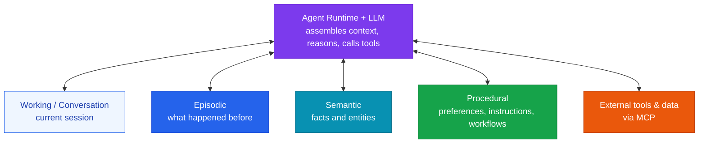

What an agent retains between steps and between sessions, and how it decides what to keep

## Memory is not state

[State management](/docs/orchestration/state-management/) keeps a single run coherent: step 2 can see what step 1 produced, and a crashed workflow resumes from its last checkpoint. That state is scoped to the run and discarded when it ends.

Memory is what survives the run. It is what lets an agent know in March what a user told it in January, recall that an approach failed last time, and apply a preference nobody repeated. The two are often stored in the same database and are constantly conflated, but they answer different questions — *where am I in this task?* versus *what do I know?* — and they have different lifetimes, different retrieval paths, and different failure modes.

## The layers

The common decomposition borrows from cognitive psychology, and the layers differ in what they hold and how long it stays true:

| Layer | What it holds | Lifetime | Typical store |
|---|---|---|---|
| **Working / conversation** | Recent turns, the active task, scratch reasoning | The session | Redis, or the context window itself |
| **Episodic** | Past interactions and their outcomes — what was tried, what happened | Months to permanent | Postgres with pgvector, or a [vector store](/docs/infrastructure/vector-db/) |
| **Semantic** | Facts about users, entities, and the domain | Until superseded | Relational tables, or a graph when relationships and validity windows matter |
| **Procedural** | Preferences, standing instructions, reusable workflows | Until the user changes them | Structured records, or text blocks injected into the system prompt |

The split is not academic bookkeeping. Each layer needs a different write policy — conversation memory is written continuously and expires on a timer, while a standing instruction should be written rarely and deliberately — and collapsing them into one undifferentiated "agent state" is a common source of agents that confidently apply something a user retracted months ago.

[MCP](/docs/infrastructure/mcp-server/) sits beside these rather than inside them: memory is what the agent retains, while MCP is how it reaches systems that hold the authoritative copy. A customer's current plan belongs in the CRM behind a tool call, not in semantic memory where it will quietly go stale.

## The lifecycle

More memory does not make a better agent. Every stored item is also a candidate for retrieval, and a store that remembers everything retrieves noise. The work is in four decisions:

| Decision | The question | What goes wrong without a policy |
|---|---|---|
| **Write** | Is this durable knowledge, or just this conversation? | Every passing remark becomes a permanent "preference" |
| **Retrieve** | Which memories are relevant to *this* request? | Retrieved history crowds out the actual question |
| **Update** | Does this supersede something already stored? | Both the old and new version come back, and the model picks one |
| **Forget** | Is this still true, and does anyone still need it? | The agent acts on facts that expired |

**Update is the one most often skipped.** Writing is easy and retrieval is well understood, but a memory layer with no notion of supersession accumulates contradictions and has no way to resolve them at read time. If a fact can change — a job title, a preference, a price — it needs either a validity window or an explicit replace-on-write path. This is why temporal knowledge graphs keep appearing in this space: they make "true as of when" a first-class property rather than something inferred from a timestamp column.

**Forgetting is a feature, not a cleanup chore.** Expiry by age, by relevance decay, and by explicit user deletion are all design decisions, and the last one is frequently also a legal requirement — see [Ethics & Compliance](/docs/governance/ethics-compliance/).

## Unified store or separate layers?

The honest answer is to start unified and split on evidence.

| Approach | Buys you | Costs you |
|---|---|---|
| **Unified store** | One write path, one retrieval path, far less to operate | Everything shares a lifetime and a ranking function, so a stale preference competes with yesterday's conversation on equal terms |
| **Separate layers** | Per-layer expiry, retrieval tuned to each kind of knowledge, deletable in isolation | More components, more consistency questions, more places to be wrong |

A workable progression: begin with conversation memory plus **one** durable store. Split out a layer when a specific failure makes the case — standing instructions getting lost in retrieval argues for procedural memory as injected text rather than a retrieved document; facts that go stale argue for semantic memory with validity windows. Splitting before that failure appears buys components you have to operate and nothing else.

## Where memory goes wrong

| Failure | What it looks like | Mitigation |
|---|---|---|
| **Stale confidence** | The agent asserts something a user corrected months ago | Supersession on write; validity windows on anything that can change |
| **Context crowding** | Retrieved memories fill the window and the model loses the actual request — the same degradation that affects [long contexts](/docs/infrastructure/ai-evaluation/) generally | Retrieve few, rank hard, and budget memory's share of the prompt explicitly |
| **Memory poisoning** | Text from an untrusted document or web page is written to memory, then replayed as trusted context in later sessions | Treat writes as an injection surface — see [Guardrails & Security](/docs/governance/guardrails/); never store raw untrusted text as fact |
| **Unbounded growth** | Retrieval quality degrades as the store grows, and cost rises with it | Consolidation and expiry as scheduled work, not as an incident response |
| **Privacy by accumulation** | Memory becomes an unplanned long-term store of personal data | Decide retention and deletion up front; log what was written and why |

Memory poisoning deserves particular attention because it inverts the usual threat model. A prompt injection normally affects one turn; an injection that reaches memory affects every future session, and arrives wearing the agent's own voice.

## The tooling landscape

The category is moving quickly and the comparisons available are mostly vendor-adjacent, so treat this as a map of approaches rather than a recommendation:

| Approach | How it works | Represented by |
|---|---|---|
| **Agent-managed blocks** | The agent edits its own memory blocks, deciding what to keep and drop | Letta, and the self-editing lineage from MemGPT |
| **Passive extraction layer** | A library watches interactions, extracts durable facts, and retrieves them later | Mem0 |
| **Temporal knowledge graph** | Facts are stored as a graph with validity intervals, so "when was this true" is queryable | Zep / Graphiti |
| **Framework-native** | Memory tools in the hot path plus background consolidation, inside an existing agent framework | LangMem with LangGraph |
| **Model-provider native** | A memory tool and context editing offered by the model provider, with compaction of older turns | Provider platform features |

Two durable observations beneath the churn. **Compaction is now a default rather than an optimization** — summarizing older turns instead of carrying them verbatim is how long sessions stay affordable, and it is a lossy write to memory, so what the summary drops is a design decision. And **the research is ahead of the practice**: 2026 surveys and critiques of agentic memory argue that many production systems still merge the cognitive layers into one state blob and lack any notion of temporal validity ([taxonomy survey](https://arxiv.org/abs/2602.19320), [knowledge-layer critique](https://arxiv.org/pdf/2604.11364)). Both are preprints and neither has been independently replicated here; they are worth reading as a checklist of what your design might be missing, not as settled findings.

## Related Categories

- [⚙️ State Management](/docs/orchestration/state-management/) — continuity within a single run, as distinct from memory across runs
- [🏗 Vector DB Optimization](/docs/infrastructure/vector-db/) — the storage layer episodic retrieval runs on
- [🛡 Guardrails & Security](/docs/governance/guardrails/) — memory writes as an injection surface
