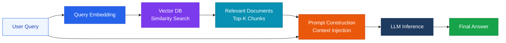
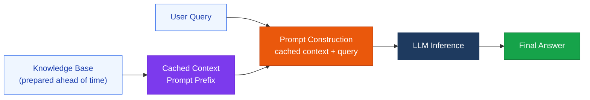
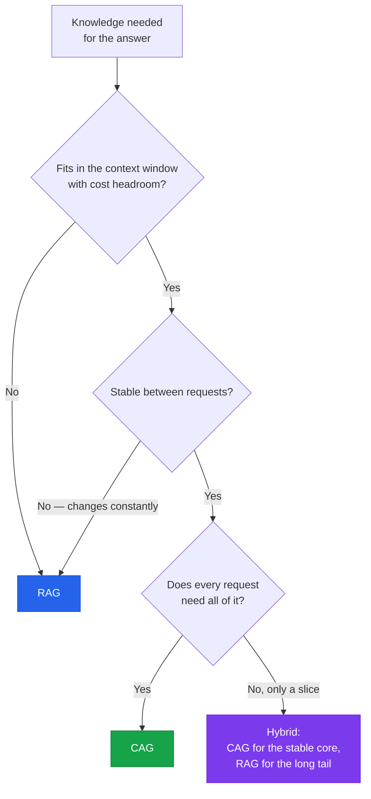

Retrieval-Augmented Generation — the core technique for connecting AI to external knowledge

## RAG Architecture



Whatever the implementation, the flow is the same five steps:

1. The user asks a question
2. The query is converted into a searchable representation — an embedding, and often keywords alongside it
3. Relevant information is retrieved from the knowledge base
4. The retrieved context is added to the prompt
5. The LLM generates the answer from that context

RAG is especially useful when your knowledge is **large, changing, or difficult to fit into the model context**. That is also the honest statement of its cost: five steps means five places to fail, and most "the model gave a wrong answer" incidents in a RAG system are retrieval incidents.

## CAG — Preloading Instead of Retrieving

**Context-Augmented Generation** takes the opposite approach: instead of searching at question time, it puts the knowledge in front of the model ahead of time.

1. Prepare the relevant knowledge in advance
2. Keep it available as context
3. Inject that context when needed
4. Generate the response from the provided knowledge



CAG is also called **cache-augmented generation**, after the mechanism that makes it affordable: the preloaded knowledge is a fixed prompt prefix, so [prompt caching](/blog/prompt-caching/) lets the provider reuse the computed attention state instead of reprocessing the whole corpus on every request. Without caching, CAG is simply an expensive prompt.

CAG can be attractive when the knowledge base is **smaller, relatively stable, and fits comfortably within the context window**.

### The key difference

> **RAG → retrieve what you need. CAG → preload what you need.**

| | RAG | CAG |
|---|---|---|
| **When knowledge is selected** | At question time | Ahead of time |
| **Moving parts** | Chunker, embedder, vector store, reranker | A prompt prefix and a cache |
| **Scales with** | Corpus size — retrieval keeps the prompt small | Context window and per-request token cost |
| **Handles updates** | Re-index the changed documents | Rebuild the prefix, invalidating the cache |
| **Typical failure** | The right passage was never retrieved | The right passage is in context but gets lost among everything else |
| **Citations** | Natural — you know which chunks you passed in | Must be asked for, and verified |

### Choosing between them



| Situation | Fit |
|---|---|
| A product handbook, a style guide, an API reference, a policy document | **CAG** — small, stable, and needed in full |
| A support knowledge base of tens of thousands of articles | **RAG** — only a few are relevant per question |
| Documents that change hourly (tickets, logs, prices) | **RAG** — re-indexing beats rebuilding a prefix |
| A fixed core plus a large archive | **Hybrid** — cache the core, retrieve the rest |
| Answers that must cite a source passage | **RAG** — retrieval gives you the citation for free |

This leads to an architectural decision worth making explicitly rather than by habit:

> **You don't automatically need RAG for every AI application.** A pipeline with a chunker, an embedding model, a vector store, and a reranker is four components to operate and four places for retrieval to go wrong. When the knowledge fits in the window and barely changes, preloading it is less machinery and usually better answers — the model sees the whole document instead of the top-K fragments a retriever guessed at.

Two cautions before defaulting to CAG. Long contexts degrade: [reasoning across a whole long input](/docs/infrastructure/ai-evaluation/) is measurably harder than retrieving one fact from it, so a 200k-token prefix is not free accuracy. And cached reads are cheaper, not free — at high request volume a large prefix on every call can cost more than running a retriever.

## Advanced RAG Patterns

### Naive RAG vs Advanced RAG

| Aspect | Naive RAG | Advanced RAG |
|---|---|---|
| **Retrieval method** | Simple vector similarity | Hybrid (vector + keyword) |
| **Reranking** | None | Cross-encoder reranking |
| **Query expansion** | Original query only | HyDE, query decomposition |
| **Chunking** | Fixed size | Semantic chunking |

### Hybrid Search

```python
# Combine vector search with BM25 keyword search
results = hybrid_search(
    query=user_query,
    vector_weight=0.7,   # semantic
    keyword_weight=0.3,  # keyword-based
    top_k=20
)
# Rerank with a cross-encoder
reranked = reranker.rank(query, results, top_k=5)
```

### HyDE (Hypothetical Document Embedding)

Generate a hypothetical answer to the query first, then search using that answer.

```
1. Query: "What impact does quantum computing have on encryption?"
2. Generate a hypothetical answer: "Quantum computing currently poses a threat to RSA encryption..."
3. Search the Vector DB using the hypothetical answer
4. Retrieval accuracy for actual relevant documents improves
```

> **Going further**: for next-generation, verification-focused strategies such as GraphRAG and Agentic RAG, see the [RAG 2.0](/docs/orchestration/rag-2-0/) page.

## RAG Evaluation Metrics

| Metric | Description | Target |
|---|---|---|
| **Faithfulness** | How well the answer is grounded in the retrieved documents | > 0.8 |
| **Answer Relevancy** | How relevant the answer is to the question | > 0.8 |
| **Context Recall** | How much of the information needed for the correct answer was retrieved | > 0.7 |
| **Context Precision** | The proportion of retrieved documents that are actually useful | > 0.6 |

**Recommended evaluation tools**: RAGAS, TruLens, LangSmith
